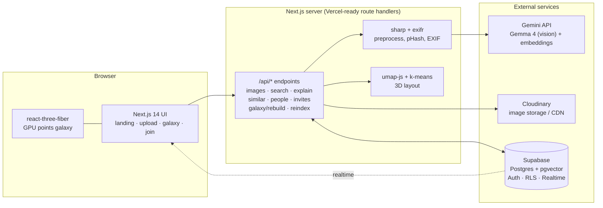
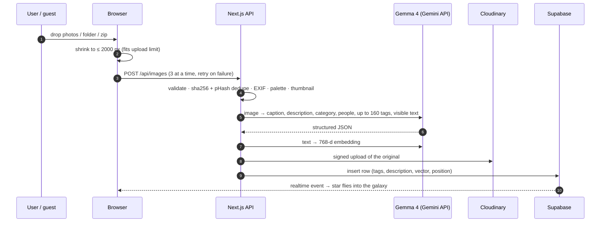

<div align="center">

# Bliss

### See what your images mean.

**A visual AI explorer that groups photos by meaning, lets you search them in plain words, and shows the evidence behind every match.**

     

[For evaluators](#-for-evaluators-start-here) · [Demo script](#-2-minute-demo-script) · [Architecture](#-architecture) · [AI pipeline](#-the-ai-pipeline) · [Run it](#-run-it-locally) · [Models and licences](#-models-and-licences) · [Honest limits](#-honest-limits)

</div>

---

## The problem

> *"Build a visual AI explorer that groups images by meaning, lets users search using natural language, and explains the visual evidence behind matches."*

Photo libraries are huge and unsearchable. Files are named `IMG_4821.jpg`, folders say nothing about content, and finding "the photo of Priya at the beach" means scrolling for minutes. Bliss turns a pile of photos into a **navigable 3D galaxy** where similar photos sit together, and an AI you can talk to in plain language.

## What it does

| | |
|---|---|
| **Groups by meaning** | Every photo is read by an AI and placed in a 3D map. Similar photos form labelled clusters ("star systems"). |
| **Searches in plain words** | "something you would cut vegetables with", "dog and cat", "the receipt from last week". Matches light up in the galaxy. |
| **Explains the evidence** | Every result carries a one-line reason and, when available, a highlighted region of the photo. |
| **Knows your people** | Name who is in a photo. Searching that name finds them. |
| **Shared galaxies** | A QR code opens a brand-new galaxy that friends fill with their phones, no accounts needed. |
| **Private by default** | Each user has their own galaxy, enforced in the database (Row Level Security). |

---

## 🧭 For evaluators: start here

<details open>
<summary><b>Where to look for each thing (click to collapse)</b></summary>

| If you want to check... | Do this | Code |
|---|---|---|
| **Groups images by meaning** | Open the galaxy. Nearby stars are similar; each cluster has a label. | [`web/lib/server/layout.ts`](web/lib/server/layout.ts), [`web/components/galaxy/Galaxy.tsx`](web/components/galaxy/Galaxy.tsx) |
| **Natural-language search** | Type a phrase in the bottom search bar of the galaxy (or on the landing page). Toggle **Highlight** / **Reorder**. | [`web/lib/server/core.ts`](web/lib/server/core.ts) (`rank`), [`web/app/api/search/route.ts`](web/app/api/search/route.ts) |
| **Visual evidence for a match** | Click a result: the panel shows "Why it matched" with evidence and a highlighted box. | [`web/app/api/explain/route.ts`](web/app/api/explain/route.ts) |
| **Open-source / open-weight AI** | Gemma 4 does the image understanding. See [Models and licences](#-models-and-licences) for exactly what is and is not open-weight. | [`web/lib/server/core.ts`](web/lib/server/core.ts) (`analyze`) |
| **Live participation** | Landing page, tap the blurred QR, scan with a phone, add a photo, watch it appear. | [`web/app/join/page.tsx`](web/app/join/page.tsx), [`web/app/api/join/`](web/app/api/join/) |
| **Bulk / folder / zip upload** | `/upload`: drop a folder, many photos, or a `.zip`. | [`web/app/upload/page.tsx`](web/app/upload/page.tsx) |
| **Accuracy of tagging** | Run the eval script (69 hand-checked images). | [`api/eval.py`](api/eval.py) |
| **Privacy / security** | Per-user Row Level Security; invite tokens are HMAC-signed. | [`supabase/migrations/002_pipeline_auth.sql`](supabase/migrations/002_pipeline_auth.sql) |

</details>

<details>
<summary><b>Suggested scoring checklist</b></summary>

- [ ] Photos are grouped into meaningful, labelled clusters
- [ ] Plain-language search returns relevant photos (and says so when nothing matches)
- [ ] Each match shows a reason / evidence, not just a score
- [ ] Open-weight AI is used and documented honestly
- [ ] Live QR participation works end to end
- [ ] The app handles errors gracefully (empty galaxy, invalid invite, failed upload with retry)
- [ ] Repository is clean: no secrets, no model weights or datasets committed, `.env.example` provided
- [ ] README explains setup, architecture and limits

</details>

## ⏱ 2-minute demo script

1. **Sign up** at `/signup` (email and password), then open **Upload**. Drop a folder or a `.zip` of photos. Progress, duplicate skipping and retries are shown per file.
2. Open the **Galaxy**. The intro plays: stars burst out of the centre into a spiral, the camera orbits, then the stars settle into their clusters. Any drag or scroll takes over; **Skip intro** / **Replay intro** are in the top right.
3. **Search** for something in plain words, e.g. `friends smiling` or `a document with text`. Try **Highlight** (matches glow, everything else dims) and **Reorder** (the whole galaxy rearranges by relevance, best matches at the centre). Click a star to see *why it matched*.
4. Click a photo and **name the people** in it (`Priya, Ravi`). Search that name.
5. Go back to the landing page and **tap the blurred QR**. It creates a brand-new, empty shared galaxy. Scan it with a phone, add a photo, and watch it fly into the galaxy on the big screen.
6. Wait for a **meteor** to cross the sky and click it: it opens a random memory.

---

## 🏗 Architecture



<details>
<summary><b>Two interchangeable backends</b></summary>

The browser talks to one API shape; where it is served from is a setting (`NEXT_PUBLIC_API_URL`).

| | **Built-in (default)** | **Python service (optional, local)** |
|---|---|---|
| Where | Next.js route handlers in `web/app/api/` | FastAPI in `api/` |
| Vision | Gemma 4 via the Gemini API | SigLIP zero-shot + YOLO11 + OpenCV faces, Gemma 4 as verifier |
| Embeddings | Gemini embedding model (768-d), from Gemma's dense description | SigLIP image embeddings (768-d) |
| Needs | Only API keys, deploys to Vercel's free tier | About 2 GB RAM and a GPU-less CPU is fine |
| Evaluated by | not covered by `eval.py` | `api/eval.py` |

The built-in backend exists because Vercel's free tier cannot host PyTorch plus model weights (250 MB function limit). The Python service is kept because it is the stricter, fully local pipeline.

</details>

## 🧠 The AI pipeline



**Per photo, in plain words**

1. **Check and fingerprint.** Reject non-images; skip exact and near-duplicates (perceptual hash).
2. **Read the metadata.** Date, camera, GPS, dominant colours.
3. **Understand it.** Gemma 4 returns a caption, a 80–150 word description, a category from a hierarchical taxonomy (people, food, nature, animals, architecture, documents, screenshots, products, art, vehicles, events), who is in it, and up to about 160 tags: objects, colours, mood, clothing, brands, visible text. If people are a main subject the category must be a people one, which fixes the classic "a person is labelled *food*" failure.
4. **Embed the meaning.** The description and tags become a 768-number vector. Similar photos get similar vectors.
5. **Store and place.** The original goes to Cloudinary; the row goes to Postgres with `pgvector`. The new star is dropped next to its nearest neighbours.

**Search**

Your query is embedded the same way. A photo counts as a match only if a query word really appears in its index (whole-word, filler words and plurals handled) **or** it is genuinely close in meaning (similarity ≥ 0.56). Named people boost their photos. If nothing qualifies, the app says so instead of showing random photos.

**Galaxy layout**

`umap-js` reduces the 768-d vectors to 3D, k-means groups them, Gemma names each group in 1–3 words, and the groups are arranged on a spaced spiral (largest in the middle) so clusters never overlap.

---

## ✨ Features

<details>
<summary><b>Galaxy (3D)</b></summary>

- GPU point field, thousands of photos at once; brightness and size reflect cluster density; one accent colour only (no rainbow)
- Always-visible squircle thumbnails that grow as you zoom (Cloudinary-transformed, mip-mapped)
- Cinematic intro (plays every open): spiral burst → fly-in → orbit → pass through the densest clusters. Skip / Replay. Respects `prefers-reduced-motion`
- **Highlight** and **Reorder** search modes; clearing animates back
- Idle drift: after 8 s without input the camera slowly orbits
- Deep-space backdrop: starfield, procedural Milky Way, clickable meteors that open a random memory
- Detail panel: caption, tags, palette, EXIF, evidence, find similar, favourite, delete, download
- Category filters; live arrivals with toast; people naming

</details>

<details>
<summary><b>Upload</b></summary>

- Drag in a whole folder, thousands of files, or `.zip` archives (unpacked in the browser)
- Concurrency-limited queue (3), exponential retry on transient errors, no retry on permanent ones
- Duplicate detection (exact and near-duplicate), progress per batch, one-click retry of failures
- Automatic re-clustering when a batch finishes

</details>

<details>
<summary><b>Shared galaxy (QR)</b></summary>

- The homepage QR is blurred until tapped; tapping creates a **brand-new empty galaxy** (a dedicated account) and a QR for it
- Friends scan, add an optional name and a photo, **no account needed**
- `Open the shared galaxy` gives a read-only live view that updates every few seconds
- Invite tokens are `owner-id.HMAC` signatures: unguessable, and revocable all at once by rotating `INVITE_SECRET`

</details>

<details>
<summary><b>Other pages</b></summary>

**Live, on your real data:** `/` landing and chat search (text and search-by-image) · `/upload` · `/galaxy` · `/join` · `/login`, `/signup` (email; Google OAuth is wired but needs enabling in Supabase) · `/admin` re-cluster and reset · branded 404 and error states.

**UI prototypes on built-in sample data (not wired to your photos, not in the navbar):** `/search` (text / image / sketch with evidence overlays), `/u/[username]` and `/profile` (profile, collections, activity, badges). They show the intended design; use the galaxy and landing search for real results.

</details>

---

## 🚀 Run it locally

### 0. Prerequisites

Node 20+, a free [Supabase](https://supabase.com) project, a free [Cloudinary](https://cloudinary.com) account, and a [Gemini API key](https://aistudio.google.com/apikey).

### 1. Database

In the Supabase SQL editor run, in order:

```text
supabase/migrations/001_init.sql
supabase/migrations/002_pipeline_auth.sql
```

For local testing, turn off **Auth → Sign In / Providers → Email → Confirm email**.

### 2. Web app (this is all you need)

```bash
cd web
cp .env.local.example .env.local     # fill in the keys (see table below)
npm install --legacy-peer-deps
npm run dev                          # http://localhost:3000
```

Sign up, open **Upload**, drop some photos, then open **Galaxy**.

<details>
<summary><b>Environment variables</b></summary>

| Variable | Where | Purpose |
|---|---|---|
| `NEXT_PUBLIC_SUPABASE_URL`, `NEXT_PUBLIC_SUPABASE_ANON_KEY` | browser | Supabase client |
| `NEXT_PUBLIC_CLOUDINARY_CLOUD_NAME` | browser | thumbnail transforms |
| `NEXT_PUBLIC_API_URL` | browser | `/api` = built-in backend (default) |
| `SUPABASE_SERVICE_ROLE_KEY` | server | shared galaxies and invites |
| `CLOUDINARY_CLOUD_NAME`, `CLOUDINARY_API_KEY`, `CLOUDINARY_API_SECRET` | server | signed uploads |
| `GEMINI_API_KEY`, `GEMINI_MODEL` | server | Gemma 4 and embeddings |
| `INVITE_SECRET` | server, optional | revoke all invites by rotating |
| `SEARCH_SIM_MATCH` | server, optional | semantic match threshold (default 0.56) |

No secret is ever committed. `.env*` and `.vercel/` are git-ignored.

</details>

### 3. Optional: the Python pipeline and its eval

```bash
cd api
uv venv -p 3.12 .venv
uv pip install -p .venv/Scripts/python.exe -r requirements.txt     # use .venv/bin/python on macOS/Linux
cp .env.example .env                                              # fill in the keys
.venv/Scripts/python.exe eval.py                                  # SigLIP + YOLO only
.venv/Scripts/python.exe eval.py --verify                         # lets Gemma arbitrate (needs GEMINI_API_KEY)
.venv/Scripts/python.exe -m uvicorn app:app --port 8000           # serve it; unset NEXT_PUBLIC_API_URL in web/.env.local
```

Needs about 2 GB of free RAM. Model weights download on first run and are **not** committed.

### 4. Deploy

The built-in backend runs on Vercel's free tier: import the `web/` directory, add the environment variables above, deploy.

---

## 📊 Evaluation

`api/eval.py` runs the Python pipeline on **69 hand-checked images** (65 Wikimedia Commons photos plus 4 synthetic screenshots, charts and pages; each label was visually verified). Several are deliberately hard: people eating, a cat eating scraps, a child hugging a dog, workers on a skyscraper beam.

| Category | Correct | Accuracy |
|---|---:|---:|
| animals | 12 / 12 | 100% |
| documents | 5 / 5 | 100% |
| nature | 6 / 6 | 100% |
| screenshots | 2 / 2 | 100% |
| people | 15 / 16 | 93.8% |
| food | 12 / 13 | 92.3% |
| vehicles | 7 / 8 | 87.5% |
| architecture | 5 / 6 | 83.3% |
| art | 0 / 1 | 0% |
| **Overall** | **64 / 69** | **92.8%** |

**The regression that started this:** a photo of a person was classified as *food*. The eval exits non-zero if any person lands in *food*; it currently **passes**.

Read this fairly:

- This number is for **SigLIP + YOLO without the verifier**. I did not complete a full `--verify` run, so the verifier's effect on the 69 images is not measured. In spot checks it fixed several of the remaining low-confidence misses.
- The built-in (default) backend uses Gemma 4 directly and is **not** covered by this eval. It was spot-checked, not benchmarked.
- 69 images is a small sample; treat percentages as indicative.

---

## 🧩 Models and licences

| Component | Open-weight? | Licence | Used for |
|---|---|---|---|
| **Gemma 4** (`gemma-4-26b-a4b-it`) | ✅ open weights | Gemma terms | Photo understanding, captions, tags, evidence, cluster names (served through the Gemini API for convenience) |
| **SigLIP** (`google/siglip-base-patch16-224`) | ✅ | Apache 2.0 | Image/text embeddings and zero-shot classification (Python pipeline) |
| **YOLO11n** (Ultralytics) | ✅ | AGPL-3.0 | Object and person detection (Python pipeline) |
| OpenCV Haar cascade | ✅ | Apache 2.0 | Face count (Python pipeline) |
| `umap-js`, `scikit-learn`, `umap-learn` | ✅ | MIT / BSD | Layout and clustering |
| **Gemini embedding model** (`gemini-embedding-001`) | ❌ **not open-weight** | proprietary API | Text embeddings in the built-in backend |

**Being straightforward about it:** the *understanding* of every photo is done by an open-weight model (Gemma 4), but the built-in backend turns that text into vectors with Google's hosted embedding API, which is not open-weight. The fully open-weight embedding path is the Python pipeline (SigLIP). We chose the hosted embeddings so the app could run on a free tier with no GPU.

Other notable libraries: Next.js, React, three.js / react-three-fiber / drei, Tailwind CSS, Supabase, Cloudinary, sharp, exifr, fflate.

---

## 🗂 Repository layout

```text
.
├── web/                       Next.js 14 app (TypeScript, Tailwind)
│   ├── app/                   pages and API route handlers
│   │   ├── api/               images · search · explain · similar · people · invites · join · galaxy/rebuild · reindex
│   │   ├── galaxy/ upload/ join/ login/ signup/ admin/   (live)  ·  search/ u/ profile/   (sample-data prototypes)
│   │   └── [token]/           QR invite landing → /join
│   ├── components/            Navbar, ChatCard, LiveWidget, galaxy/{Galaxy,DetailPanel}
│   └── lib/                   supabase client, shrink, server/{core,layout}
├── api/                       optional Python pipeline (FastAPI, SigLIP, YOLO11) + eval.py + eval_set.json
└── supabase/migrations/       001_init.sql, 002_pipeline_auth.sql
```

---

## 🔒 Security and privacy

- **Row Level Security** on every table: a user can only read and write their own images, clusters, searches and explanations.
- Server secrets (service role, Cloudinary secret, Gemini key) exist only in server environment variables.
- Invite links are HMAC-signed, and a shared galaxy is a **separate account**, so a leaked QR exposes only that demo galaxy, never anyone's personal one.
- Guest uploads and the guest galaxy view are read-limited: no embeddings, no owner-only actions.
- Inputs are validated (type, size ≤ 30 MB); the post-login redirect only accepts same-site paths.

## ⚠️ Honest limits

We would rather you hear these from us:

- **Search quality depends on Gemma's description.** If the model misses a detail, search can too.
- **Older photos** indexed by the first pipeline use a different vector format; the `/api/reindex` endpoint upgrades them, and the galaxy runs it automatically on open. Until then they rank poorly.
- **Clustering** uses k-means on UMAP output, not density-based HDBSCAN (which has no JavaScript implementation). The Python pipeline uses HDBSCAN.
- **Vercel body limit:** uploads are shrunk in the browser to fit the 4.5 MB request cap.
- **Free-tier realities:** the Gemini API has rate limits; very large bulk uploads will be throttled and retried.
- **Prototype pages:** `/search`, `/u/*` and `/profile` use sample data (see above).
- **Not built (cut for time):** lasso and bulk actions, album editing, timeline view, minimap, 2D/3D toggle, duplicate-finder UI (duplicates are skipped at upload), colour/date filters, EXIF map.
- Eval covers the Python pipeline only (see above).

## 🏁 Hackathon compliance

- [x] Open-source / open-weight AI theme: Gemma 4 and SigLIP, documented above
- [x] Working prototype with a live demo path (QR participation)
- [x] Repository free of secrets, weights and datasets; `.env.example` files provided
- [x] Graceful failure: invalid invite, empty galaxy, failed uploads retried, error boundaries
- [ ] Hosted deployment (runs locally and through a tunnel; the Vercel deploy is prepared but not finished)

---

<div align="center">

Built in one day for **MLH Hacktoberfest Hack Day** · Team ACDC

</div>
